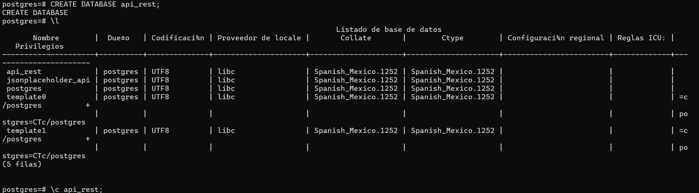
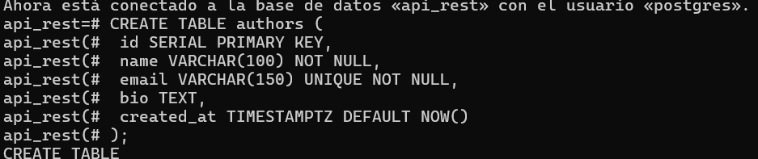
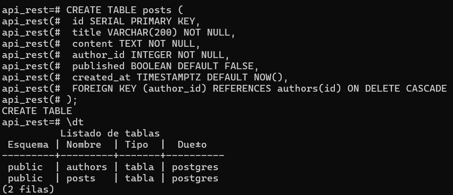
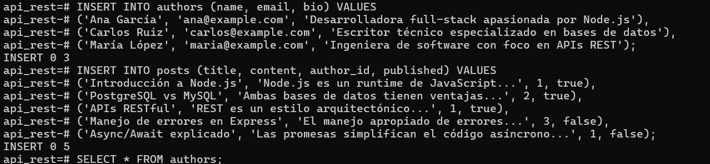
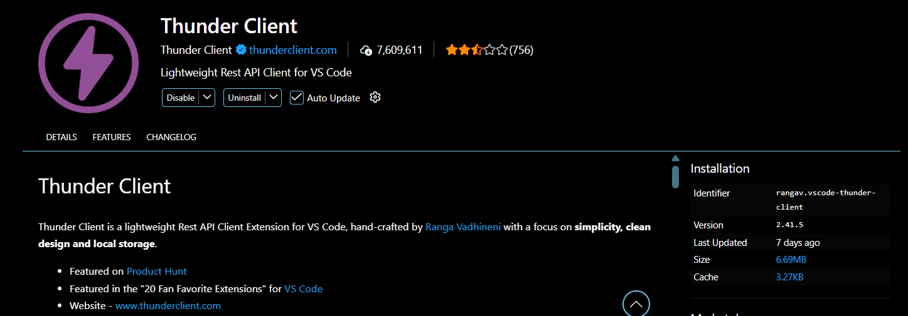
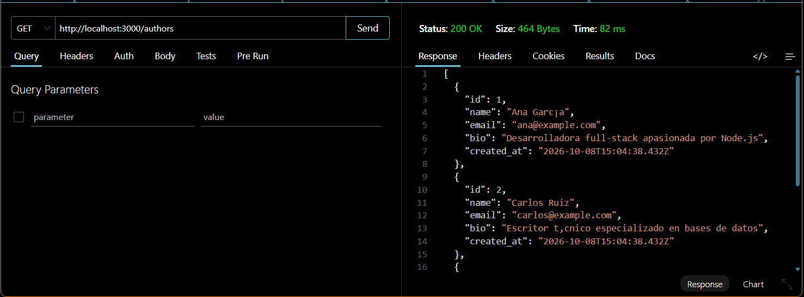

# API REST - Authors & Posts

API REST desarrollada con Node.js, Express y PostgreSQL.

## Tecnologías

- Node.js
- Express
- PostgreSQL
- pg
- Jest
- Supertest

## Instalación

Clonar el proyecto:
git clone URL_DEL_REPOSITORIO

una vez clonado el repositorio o descargado
todos los comandos usados estan en scripts.sql
Deberas iniciar tu database con PSQL
Para eso abrimos PSQL configuramos el usuario y seguido de eso en posgress usamos 
- ### CREATE DATABASE api.rest;
- ### si necesitas ver la lista de database \l
- ### para seleccionar un database \c nombre

## para crear las tablas simplemente utiliza el comando una vez seleccionado el database 
- ### CREATE TABLE authors (pegar datos de scripts.sql)
- ### CREATE TABLE posts (pegar datos de scripts.sql)
- ### ver listas de tablas \dt

## para seleccionar e insertar datos
- ### INSERT INTO authors (name, email, bio) VALUES
- ### INSERT INTO posts (title, content, author_id, published) VALUES
- ### para ver el contenido de las tablas = SELECT * FROM authors;

- ## una vez configurado esto en tu editor de codigo (visual studio)
- deberas configurar tu .env 
- iniciarlo con el comando en la terminal bash "node src/server.js"
- antes deberias instalarte la extension thunderclient

- PORT=3000
- DB_HOST=localhost
- DB_PORT=5432
- DB_NAME=api_rest 
- DB_USER=postgres
- DB_PASSWORD=tu_password

### Cruds y extension
para probar los metodos CRUD deberas instalarte esta extension

### Seguido de eso con thunder client podras probar los metodos CRUD de manera facil 
Cuando se inicie tu localhost

## Endpoints
- Authors

| Método | Endpoint             | Descripción     |
| ------ | -------------------- | --------------- |
| GET    | `/authors`           | Obtener todos   |
| GET    | `/authors/:id`       | Obtener uno     |
| GET    | `/authors/:id/posts` | Posts del autor |
| POST   | `/authors`           | Crear           |
| PUT    | `/authors/:id`       | Actualizar      |
| DELETE | `/authors/:id`       | Eliminar        |

- Posts

| Método | Endpoint     | Descripción   |
| ------ | ------------ | ------------- |
| GET    | `/posts`     | Obtener todos |
| GET    | `/posts/:id` | Obtener uno   |
| POST   | `/posts`     | Crear         |
| PUT    | `/posts/:id` | Actualizar    |
| DELETE | `/posts/:id` | Eliminar      |

